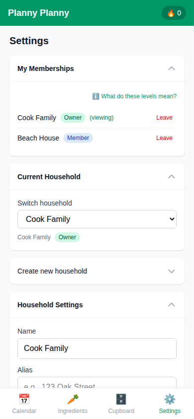

# @Households

The active household is shared across the app, other devices, and the
[Claude/ChatGPT MCP connector](claude-integration.md#household-tools-and-permissions)
through `profiles.last_household_id`. Automatic app selections are saved after
preferences load; later connector switches update the open app even after a
manual in-app switch.

Creating, selecting, configuring, and synchronising households.

## Why it matters

This capability helps a household plan, decide, or collaborate with less friction. The value is measured by the user journey below: a person can discover the capability, complete the task, and see the result reflected in the shared meal-planning experience.

## User journey

1. Start from the relevant app screen or entry point.
2. Provide the small amount of information the household needs for this task.
3. Confirm the action and review the resulting state.
4. Return later to see the state preserved and, where applicable, synchronised for other household members.

## Screenshots and visual walkthrough

Capture these states at the mobile viewport (390×844) and add the resulting images under `docs/screenshots/households/`:

| State | Suggested filename |
| --- | --- |
| Entry point | `01-entry.png` |
| In-progress or empty state | `02-in-progress.png` |
| Completed state | `03-complete.png` |
| Edge case or permission state | `04-edge-case.png` |

The Playwright BDD scenarios are the source of truth for the journey. A scenario can save a snapshot with `await page.screenshot({ path: 'docs/screenshots/households/04-edge-case.png', fullPage: true })`; keep screenshots deterministic and refresh them when the behaviour changes.

## Tests and implementation

- [Search all `@Households` references](https://github.com/colinccook/planny-planny/search?q=@Households&type=code)
- [Search the feature directory](../features.md)

## Maintenance

Update this page, its screenshots, and the linked scenarios whenever the user journey or value proposition changes.
